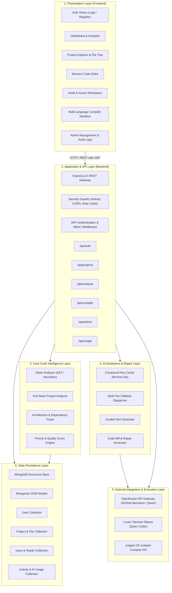

# CodeLab

> **AI-Powered Code Analysis & Issue Prioritization Platform**

CodeLab is an enterprise-grade full-stack developer platform engineered to analyze software repositories, identify static defects and security vulnerabilities across architectural layers, mathematically prioritize findings, and generate automated AI-assisted code repairs and pedagogical hints.

---

## 📌 Project Overview

Modern software development relies heavily on distributed components, RESTful APIs, and complex client-server interactions. Conventional linters and single-file static analysis tools inspect source files in isolation, often missing systemic regressions such as route contract mismatches between frontend network requests and backend handlers, unhandled asynchronous rejections, broken local module imports, and hardcoded authentication credentials.

CodeLab bridges this gap by unifying:
1. **Whole-Project Abstract Syntax & Heuristic Discovery:** Inspecting entire repositories to map relationships across client components, backend controllers, data models, and dependencies.
2. **Deterministic Issue Prioritization:** Calculating objective numerical priority scores combining issue severity, flaw type, and codebase impact.
3. **Multi-Tier AI Intelligence Cascade:** Providing deep semantic explanations, risk assessments, and unified diff patches with automatic failover across cloud LLMs and local inference engines.
4. **Sandboxed Code Execution:** Running multi-language code snippets securely using isolated compiler integrations.

---

## 🔍 Problem Statement

Software engineering teams face several recurring challenges during development and peer review:
* **Siloed Static Inspection:** Standard linters evaluate individual files without understanding project-wide context, missing cross-file API mismatches and dependency breaks.
* **Alert Fatigue & Poor Prioritization:** Analyzing a complex repository often produces hundreds of raw warnings without clear guidance on what must be resolved immediately versus what is cosmetic.
* **Lack of Actionable Remediation:** Traditional security scanners flag vulnerabilities (e.g., SQL/NoSQL injection risks or insecure CORS configurations) without providing actionable code fixes or automated git-ready diffs.
* **Prohibitive Cloud AI Costs:** Continuously sending entire codebases to commercial cloud LLMs causes significant latency, vendor lock-in, and unpredictable token expenditures.

---

## 🎯 Project Objectives

* **Comprehensive Full-Stack Static Auditing:** Detect security vulnerabilities, architectural contract mismatches, code smells, and performance bottlenecks across multi-tier web applications.
* **Mathematical Defect Prioritization:** Implement a clear scoring algorithm that maps issue severity and category to an actionable priority score and overall project health score ($0 - 100$).
* **Cross-Layer Topology Mapping:** Automatically discover and visualize dependency relationships between presentation components, API endpoints, backend controllers, and database schemas.
* **Cost-Aware Resilient AI Assistance:** Provide contextual bug explanations and automated code repairs using a 3-tier failover engine (Cloud LLMs $\leftrightarrow$ Local Ollama $\leftrightarrow$ Remote GPU).
* **Integrated Developer Workspace:** Deliver an in-browser development environment powered by the Monaco Editor and multi-language compilation sandboxes.

---

## ✨ Key Features

### A. Code Analysis
* **Static Code Analysis:** Pattern and AST heuristic matching evaluating JavaScript, TypeScript, Python, and other languages for syntax defects, deprecated methods, and anti-patterns.
* **Full-Stack Project Analysis:** Whole-repository inspection detecting cross-module anomalies, unhandled exceptions, and dead code.
* **Code Quality Analysis:** Evaluates cyclomatic complexity heuristics, function line counts, maintainability indices, and error-handling consistency.
* **Architecture Analysis:** Traces application entry points, controller-to-model interactions, and structural relationships.
* **Dependency Analysis:** Identifies broken local relative imports, missing packages, and circular module references.
* **API Contract Analysis:** Verifies alignment between frontend client calls (`api.get`, `api.post`) and declared Express route signatures and HTTP methods.

### B. Security Analysis
* **Vulnerability Detection:** Scans for OWASP Top 10 risks including injection flaws (`eval()`, unparameterized queries), Cross-Site Scripting (`innerHTML`, `document.write`), and command injection hazards.
* **Secret & Credential Auditing:** Flags hardcoded API keys, private tokens, passwords, and sensitive environment strings.
* **Authentication & Authorization Checks:** Identifies unauthenticated sensitive routes, missing authorization middleware guards, and weak cryptographic practices.
* **API Security Analysis:** Verifies HTTP header hardening, Cross-Origin Resource Sharing (CORS) configurations, and body payload limits.

### C. Issue Detection & Prioritization
* **Multi-Category Classification:** Categorizes findings into `Security`, `Bug`, `Code Smell`, `Complexity`, `Maintainability`, `Performance`, and `Syntax`.
* **Four-Tier Severity Scale:** Ranks issues as `Critical`, `High`, `Medium`, or `Low`.
* **Objective Priority Scoring:** Calculates composite scores using deterministic weighting:
  $$\text{Priority Score} = \text{Severity Weight} + \text{Category Weight}$$
* **Project Quality Health Score:** Evaluates overall project posture starting at 100 with deduction penalties:
  $$\text{Quality Score} = \max\left(0,\, 100 - (25 \times \text{Critical} + 10 \times \text{High} + 4 \times \text{Medium} + 1 \times \text{Low})\right)$$

### D. AI Assistance & Repair
* **AI Hint Generation (Educational Mode):** Produces guided troubleshooting hints without giving away the direct answer, ideal for learning environments.
* **In-Depth Issue Explanation:** Details root cause analysis, severity rationale, and concrete exploit or failure scenarios.
* **Automated Code Repair:** Generates production-ready replacement code fixing the identified defect.
* **Interactive Code Diff Generation:** Displays side-by-side or inline unified git diffs before applying modifications.
* **Accept / Reject Workflow:** Empowers developers to review proposed changes and apply them directly into workspace files with one click.
* **Compound Result Caching:** Caches AI explanations by `${file}:${line}:${rule}` to prevent redundant token consumption on re-audits.

### E. Code Editor & Execution
* **Monaco Editor Integration:** Embedded VS Code editor engine supporting syntax highlighting, bracket matching, line numbering, and keyboard shortcuts.
* **Virtual Project & File Explorer:** Create, rename, delete, open, edit, and upload files across custom directory trees.
* **Auto-Save Engine:** Debounced automatic background persistence with manual override capabilities.
* **Multi-Language Sandbox Compiler:** Integrated compiler environment executing code across 16 programming languages (Node.js, TypeScript, Python, C, C++, Java, Go, Rust, and more) with real-time output and error parsing.

### F. Dashboard & Analytics
* **Executive Summary Dashboard:** Visualizes overall code health, total projects, aggregate findings, and average quality scores.
* **Interactive Metric Visualizations:** Priority distribution bar charts, severity donut breakdowns, and defect density trends powered by Recharts.
* **Historical Audit Logs:** Tracks project quality scores and issue counts over successive analysis runs.
* **Token Usage & Cost Auditing:** Tracks AI token expenditures, model consumption, and estimated costs per user.
* **Administrative Operations:** Platform oversight dashboard for managing user accounts, auditing system logs, and monitoring platform status.

---

## 🏗️ System Architecture

CodeLab is built upon a decoupled six-layer system architecture designed for horizontal scalability, clear separation of concerns, and robust security isolation:



### Layer Descriptions

1. **Presentation Layer (Frontend):** Responsive Single Page Application (SPA) built with React 19 and Vite. Utilizes Tailwind CSS and custom design variables for a modern light/dark interface, Framer Motion for micro-interactions, Recharts for visual analytics, and Monaco Editor for real-time coding.
2. **Application & API Layer (Backend):** Built on Node.js and Express 5. Implements transport-level and header security (Helmet), scoped CORS, JSON request payload limits, and JSON Web Token (JWT) cryptographic authentication with role-based route guards.
3. **Core Code Intelligence Layer:** The deterministic heart of the platform. Evaluates source code using regex patterns and structural heuristic parsers, performs cross-file API contract pairing, identifies dependency flaws, and computes objective priority weights.
4. **AI Assistance & Repair Layer:** Orchestrates prompt assembly, JSON extraction, and code diff synthesis. Features an intelligent caching mechanism to reuse explanations for known issues and dispatches requests across active AI tiers.
5. **External Integration & Execution Layer:** Provides abstracted adapters for third-party cloud services: OpenRouter cloud LLMs, local/remote Ollama inference instances, and Judge0 sandboxed code execution environments.
6. **Data Persistence Layer:** Stores user profiles, project source trees, detected issue records, audit snapshots, and token usage analytics in MongoDB via Mongoose schema models.

---

## 💻 Technology Stack

### Frontend Ecosystem
* **Core Framework:** React (v19.2.8)
* **Build Tool & Bundler:** Vite (v8.3.0)
* **Routing:** React Router DOM (v7.18.4)
* **Styling & Design:** Tailwind CSS (v3.4.19), PostCSS, Autoprefixer
* **Code Editor:** `@monaco-editor/react` (v4.7.0)
* **Animation & Motion:** Framer Motion (v13.5.0)
* **Data Visualization:** Recharts (v3.10.1)
* **Icons:** Lucide React (v1.49.0)
* **HTTP Client:** Axios (v1.20.0)
* **Notifications:** React Hot Toast (v2.6.1)
* **Date Utilities:** date-fns (v4.4.0)
* **OAuth Client:** `@react-oauth/google` (v0.13.5)

### Backend Ecosystem
* **Runtime:** Node.js (v18.0.0+ / v20.0.0+)
* **Application Framework:** Express.js (v5.2.1)
* **Database Driver & ODM:** Mongoose (v9.10.3)
* **Authentication & Security:** JSON Web Token (`jsonwebtoken` v9.0.3), `bcryptjs` (v3.0.3), `helmet` (v8.3.0), `cors` (v2.8.6)
* **Data Validation:** Zod (v4.6.5)
* **File Upload Handling:** Multer (v2.4.0)
* **Logging:** Morgan (v1.12.1)
* **HTTP & Integrations:** Axios (v1.20.0), OpenAI Node SDK (v7.25.0), `google-auth-library` (v11.1.0)
* **Process Management:** Nodemon (v3.1.14 dev dependency)

### External Services & Storage
* **Database:** MongoDB (Local or Atlas, v6.0+)
* **AI Provider Interfaces:** OpenRouter API, Ollama (Local/Remote GPU), OpenAI SDK
* **Code Execution Sandbox:** Judge0 CE (Public, RapidAPI, or Self-Hosted)

---

## 📁 Project Folder Structure

```
CodeLab/
├── README.md                           # Master project documentation
├── CODELAB_SYSTEM_ARCHITECTURE.md      # Detailed system architecture specification
│
├── codelab-backend/                    # Backend server & services
│   ├── package.json                    # Backend dependencies and scripts
│   ├── server.js                       # Express server entry point & middleware setup
│   ├── .env.example                    # Backend environment configuration template
│   ├── KAGGLE_OLLAMA_SETUP.md          # Guide for remote GPU inference tunnels
│   ├── test_audit_regression.js        # Automated regression test suite
│   └── src/
│       ├── config/
│       │   └── pricing.js              # Token and API cost calculation configuration
│       ├── middleware/
│       │   └── auth.js                 # JWT verification & role authorization guards
│       ├── models/
│       │   ├── Activity.js             # User action and event logging schema
│       │   ├── AiUsage.js              # Token consumption and cost accounting schema
│       │   ├── Issue.js                # Detected issue, triage, and repair schema
│       │   ├── Project.js              # Project metadata, files, and audit schema
│       │   └── User.js                 # User profile and credentials schema
│       ├── routes/
│       │   ├── admin.js                # Administrative management endpoints
│       │   ├── ai.js                   # Assistant chat and direct AI endpoints
│       │   ├── analysis.js             # Audit execution, issue triage, and repair routes
│       │   ├── auth.js                 # Registration, login, and user profile routes
│       │   ├── compiler.js             # Code execution proxy endpoints
│       │   ├── projects.js             # Project and virtual file CRUD routes
│       │   └── usage.js                # Token and cost statistics routes
│       ├── services/
│       │   ├── compilerService.js      # Judge0 API integration with mock fallback
│       │   ├── e2eAnalyzer.js          # Full-stack cross-file verification engine
│       │   ├── openaiService.js        # Multi-tier AI completion & diff generator
│       │   └── staticAnalyzer.js       # Pattern-based static AST analysis engine
│       └── utils/
│           ├── activityLogger.js       # Helper for logging user activities
│           ├── languageDetector.js     # Automatic file language detection
│           └── seedUsers.js            # Default administrative account seeder
│
└── codelab-frontend/                   # Frontend client application
    ├── package.json                    # Frontend dependencies and scripts
    ├── vite.config.js                  # Vite configuration and backend API proxy
    ├── index.html                      # HTML document entry point
    ├── postcss.config.js               # PostCSS configuration
    ├── tailwind.config.js              # Tailwind CSS utility definitions
    └── src/
        ├── App.jsx                     # Root router, route guards, and providers
        ├── main.jsx                    # React application mounting point
        ├── index.css                   # Global styles, variables, and typography
        ├── assets/                     # Static brand assets and illustrations
        ├── components/
        │   ├── layout/
        │   │   ├── Layout.jsx          # Primary authenticated layout wrapper
        │   │   └── Sidebar.jsx         # Collapsible main navigation sidebar
        │   └── ui/
        │       ├── AnimatedNumber.jsx  # Smooth numeric counter component
        │       ├── ScrollReveal.jsx    # Scroll animation trigger component
        │       ├── SpotlightCard.jsx   # Radial gradient cursor-tracking card
        │       └── TiltCard.jsx        # 3D interactive tilt container
        ├── contexts/
        │   ├── AuthContext.jsx         # User authentication state & session manager
        │   ├── ProjectContext.jsx      # Active workspace & file tree state manager
        │   └── ThemeContext.jsx        # Light/Dark mode state manager
        ├── lib/
        │   └── api.js                  # Axios client with automatic JWT interceptors
        └── pages/
            ├── AdminDashboard.jsx      # Platform administration view
            ├── AIAssistant.jsx         # Interactive code guidance view
            ├── Analysis.jsx            # End-to-End Application Audit dashboard
            ├── Analytics.jsx           # Quality score trends and metrics view
            ├── CodeEditor.jsx          # Integrated Monaco code editor view
            ├── Compiler.jsx            # Multi-language code execution view
            ├── Dashboard.jsx           # Main user overview and statistics view
            ├── Issues.jsx              # Comprehensive issue explorer & triage view
            ├── Login.jsx               # Interactive authentication entry view
            ├── Profile.jsx             # User profile and account security view
            ├── Projects.jsx            # Project workspace management view
            └── Register.jsx            # New user registration view
```

---

## ⚙️ Installation and Setup

### Prerequisites
* **Operating System:** Windows 10/11 (or macOS / Linux)
* **Node.js:** Version 18.x or 20.x installed ([Download Node.js](https://nodejs.org/))
* **Git:** Version control client installed ([Download Git](https://git-scm.com/))
* **MongoDB:** Community Server running locally on port 27017 ([Download MongoDB](https://www.mongodb.com/try/download/community)) or a MongoDB Atlas cloud URI.

---

### Step 1: Clone the Repository
Open PowerShell or your preferred command line and clone the repository:
```powershell
git clone https://github.com/your-username/codelab.git
cd codelab
```

---

### Step 2: Configure and Start MongoDB
Ensure your local MongoDB daemon is running:
```powershell
# In PowerShell or Windows Services:
net start MongoDB
# Or if installed standalone:
mongod --dbpath "C:\data\db"
```

---

### Step 3: Install Backend Dependencies & Configure Environment
1. Navigate to the backend directory:
   ```powershell
   cd codelab-backend
   npm install
   ```
2. Create your local environment configuration file:
   ```powershell
   copy .env.example .env
   ```
3. Edit `codelab-backend/.env` with your preferred configuration (see [Environment Variables](#-environment-variables-configuration)).

---

### Step 4: Install Frontend Dependencies
1. Open a new terminal window and navigate to the frontend directory:
   ```powershell
   cd codelab-frontend
   npm install
   ```

---

## 🔐 Environment Variables Configuration

Create a file named `.env` inside `codelab-backend/`. Use the table below as a guide:

| Variable Name | Purpose | Required / Optional | Default / Example Value |
| :--- | :--- | :---: | :--- |
| `PORT` | HTTP port on which the Express server listens | Optional | `5000` |
| `MONGODB_URI` | Connection URI for the MongoDB instance | **Required** | `mongodb://localhost:27017/codelab` |
| `JWT_SECRET` | Secret key used to sign and verify JSON Web Tokens | **Required** | `your_secure_random_jwt_secret_key` |
| `JWT_EXPIRES_IN` | Token validity duration | Optional | `7d` |
| `FRONTEND_URL` | Permitted origin for Cross-Origin Resource Sharing (CORS) | Optional | `http://localhost:3000` |
| `NODE_ENV` | Application environment mode (`development` / `production`) | Optional | `development` |
| `ADMIN_EMAIL` | Account email that automatically receives admin privileges | Optional | `admin@codelab.dev` |
| `GOOGLE_CLIENT_ID` | Google OAuth Client ID for social login | Optional | `your_google_client_id.apps.googleusercontent.com` |
| `USE_OPENROUTER_ONLY` | Sets OpenRouter as primary AI tier when set to `true` | Optional | `true` |
| `OPENROUTER_API_KEY` | API key for OpenRouter cloud LLM gateway | Optional | `sk-or-v1-your-openrouter-key` |
| `AI_MODEL` | OpenRouter model identifier | Optional | `nvidia/nemotron-3.5-lightning:free` |
| `REMOTE_GPU_BASE_URL` | Base URL for remote GPU tunnel (e.g., Cloudflare tunnel to Kaggle) | Optional | `https://your-tunnel.trycloudflare.com/v1` |
| `REMOTE_GPU_MODEL` | Model hosted on the remote GPU instance | Optional | `qwen2.5-coder:7b` |
| `REMOTE_GPU_TIMEOUT_MS`| Request timeout for remote GPU in milliseconds | Optional | `60000` |
| `LOCAL_CPU_BASE_URL` | Base URL for local Ollama instance | Optional | `http://localhost:11434/v1` |
| `LOCAL_CPU_MODEL` | Model installed in local Ollama | Optional | `qwen2.5-coder:7b` |
| `LOCAL_CPU_TIMEOUT_MS` | Request timeout for local Ollama in milliseconds | Optional | `25000` |
| `OPENAI_API_KEY` | Direct OpenAI API key (if using official OpenAI endpoints) | Optional | `sk-your-openai-key` |
| `JUDGE0_API_KEY` | RapidAPI key for Judge0 CE code execution sandbox | Optional | `your_rapidapi_judge0_key` |
| `JUDGE0_URL` | Custom Judge0 instance URL (uses public CE by default) | Optional | `https://ce.judge0.com` |
| `MAX_AI_COST_PER_USER` | Cumulative AI spending limit per user in USD | Optional | `5.00` |

> ⚠️ **Important Security Notice:** Never commit your `.env` file to version control. Keep all API keys, database credentials, and cryptographic secrets confidential.

---

## 🚀 How to Run the Application

The application requires two active terminal sessions (one for the backend API and one for the frontend client).

### Terminal 1: Start Backend Server
```powershell
cd codelab-backend
node server.js
```
*Expected Output:*
```
✅ MongoDB connected
🚀 CodeLab Backend Server running on port 5000
```

### Terminal 2: Start Frontend Development Client
```powershell
cd codelab-frontend
npm run dev
```
*Expected Output:*
```
  VITE v8.3.0  ready in 450 ms

  ➜  Local:   http://localhost:3000/
  ➜  Network: use --host to expose
```

### Accessing the Web Application
Open your web browser and navigate to:
**[http://localhost:3000](http://localhost:3000)**

*Note: The first user to register an account automatically receives Administrator privileges based on `ADMIN_EMAIL` configuration.*

---

## 🔄 Application Workflow

```text
  [ User Registers / Logs In ]
                │
                ▼
  [ Create or Import Project ] ────► [ Monaco Code Editor: Add / Edit / Upload Files ]
                │                                           │
                ▼                                           ▼
  [ Trigger End-to-End Audit ] ◄──────────────────── [ Debounced Auto-Save ]
                │
                ├─────────────────────────────────────────────────┐
                ▼                                                 ▼
   1. Static AST / Regex Engine                     2. Full-Stack Analyzer
   - Syntax & deprecated APIs                       - Cross-file API contracts
   - Hardcoded secrets & injection                  - Route-to-controller mapping
   - Function complexity heuristics                 - Broken relative imports
                │                                                 │
                └───────────────────────┬─────────────────────────┘
                                        ▼
                 [ Compute Objective Priority Scores ]
                 - Priority = Severity + Category weight
                 - Calculate Quality Score (0 - 100)
                                        │
                                        ▼
                  [ Check AI Compound Cache (MongoDB) ]
                  - Key: `${file}:${line}:${rule}`
                  - Cache Hit? Reuse existing explanation
                                        │
                         ┌──────────────┴──────────────┐
                         ▼                             ▼
                  [ Cache Hit ]                 [ Cache Miss ]
                  - Attach to Issue             - Batch top 5 files by defect count
                                                - Dispatch to AI Engine (OpenRouter / Ollama)
                                                - Generate Explanations & Patch Diffs
                                                       │
                                                       ▼
                                          [ Persist Analysis & Issues ]
                                                       │
                                                       ▼
                                         [ Review Issues in Dashboard ]
                                                       │
                                        ┌──────────────┴──────────────┐
                                        ▼                             ▼
                                  [ Hint Mode ]                 [ Full Mode ]
                                  - Read guidance               - Inspect Side-by-Side Diff
                                  - Fix manually                - Click "Accept Repair"
                                                                      │
                                                                      ▼
                                                       [ Atomic File Patch Applied ]
                                                                      │
                                                                      ▼
                                                       [ Re-Run Verification Audit ]
```

1. **Authentication:** The user registers or signs in using JWT credentials or Google OAuth.
2. **Project Setup:** The user creates a new project or opens an existing workspace.
3. **Source Code Management:** The user creates, edits, or uploads multi-file source directories inside the Monaco editor.
4. **Triggering Analysis:** The user clicks **Run Full Audit** from the Code Editor or the Analysis dashboard.
5. **Static & Structural Examination:** The backend executes the static pattern scanner and the full-stack architecture analyzer.
6. **Scoring & Prioritization:** Detected findings receive deterministic scores, and the project's overall Quality Score is updated.
7. **Cache Verification:** The system checks MongoDB for previously analyzed issues matching `${file}:${line}:${rule}` to avoid redundant AI calls.
8. **AI Semantic Enrichment:** For un-cached issues, the top files are dispatched to the multi-tier AI engine to generate root-cause explanations and code diffs.
9. **Persistence & Sync:** All issues, priority scores, and project audit summaries are saved to MongoDB.
10. **Review & Repair:** The user inspects findings grouped by priority (`Critical`, `High`, `Medium`, `Low`).
11. **One-Click Patch Application:** The user reviews the generated diff and clicks **Accept Repair**, which updates the virtual source file automatically.

---

## 🤖 AI Integration and Code Execution

### AI Multi-Tier Dispatcher
CodeLab implements a 3-tier completion architecture with automated failover in `codelab-backend/src/services/openaiService.js`:

* **Tier 1 (Cloud Gateway):** Connects to the **OpenRouter API** using high-throughput open models (default: `nvidia/nemotron-3.5-lightning:free` or Qwen).
* **Tier 2 (Remote GPU Tunnel):** Connects to remote GPU compute instances (e.g., Kaggle or Google Colab environments running Ollama exposed via secure Cloudflare Tunnels).
* **Tier 3 (Local CPU Inference):** Connects to a locally running **Ollama** server (`http://localhost:11434/v1`) running lightweight developer models like `qwen2.5-coder:7b`.

> **Graceful Fallback:** If a cloud provider encounters HTTP 429 rate limits, the dispatcher automatically routes the request to the next available tier. If no AI providers are configured or online, static analysis continues to function normally with clear notification badges.

### Multi-Language Sandbox Code Execution
CodeLab integrates with the **Judge0 API** in `codelab-backend/src/services/compilerService.js`:
* **Supported Languages:** JavaScript (Node.js), TypeScript, Python 3, C, C++, C#, Java, Go, Rust, Ruby, PHP, Swift, Kotlin, Bash, R, and SQL.
* **Execution Feedback:** Returns real-time compilation stdout, execution stderr, exit codes, execution duration (seconds), and peak memory usage (KB).
* **Mock Execution Fallback:** When Judge0 API keys are not configured or external sandboxes are unavailable, the compiler service provides predictable simulated execution responses so developers can test frontend workflows offline.

---

## 🛡️ Security Features

The CodeLab platform incorporates defense-in-depth principles across all layers:

* **Cryptographic Password Hashing:** User passwords are encrypted using `bcryptjs` with a work factor of 12 salt rounds before storage.
* **Stateless JWT Authentication:** Access tokens signed with HMAC-SHA256 authenticate all protected API endpoints via Bearer token authorization headers.
* **Role-Based Access Control (RBAC):** Privileged endpoints under `/api/admin` require explicit `admin` role authorization.
* **Strict Tenant Isolation:** Database queries enforce document-level ownership checks (`owner: req.user._id`), preventing Insecure Direct Object Reference (IDOR) attacks.
* **HTTP Header Security:** The `helmet` middleware suite enforces secure HTTP response headers, content security policies, and anti-clickjacking protection.
* **CORS Origin Restriction:** Cross-Origin requests are restricted strictly to the configured `FRONTEND_URL`.
* **Safe Static Parsing:** Code inspection and cross-layer topology tracing are performed using deterministic static regex parsing and AST traversal, eliminating the risk of arbitrary code execution during project analysis.
* **Payload Size Constraints:** Body parsers enforce strict 10MB limits on multipart form uploads and JSON payloads to prevent Denial of Service (DoS) attacks.

---

## 🔮 Future Enhancements

The following capabilities represent potential directions for ongoing platform development:
* **Abstract Syntax Tree (AST) Deep Parsing:** Transitioning from regex-based heuristic scanners to full AST parsing (e.g., via Babel or Tree-sitter) for deeper semantic data-flow analysis.
* **Automated Test Generation:** Synthesizing Jest, Mocha, or PyTest unit test suites automatically based on discovered API contract schemas.
* **Git Remote Synchronization:** Direct integration with GitHub, GitLab, and Bitbucket for automated Pull Request auditing and branch scanning.
* **Containerized Execution Sandboxes:** Deploying isolated Docker/gVisor micro-containers for dynamic runtime profiling alongside static heuristics.
* **Custom Security Rule Builder:** Allowing teams to author custom organizational compliance checks using YAML or Rego rules.

---

## 📸 Screenshots

To populate screenshots in your documentation, place your image files in `docs/screenshots/` and update the relative links below:

| View | Screenshot Placeholder |
| :--- | :--- |
| **Authentication & Login** | `` |
| **Platform Dashboard** | `` |
| **Virtual Project Workspace** | `` |
| **Monaco Code Editor** | `` |
| **End-to-End Audit Dashboard** | `` |
| **Issue Management & Triage** | `` |
| **Interactive AI Code Repair** | `` |
| **Multi-Language Compiler** | `` |

---

## 📄 License

This project is developed for educational, academic, and portfolio demonstration purposes.  
Licensed under the [MIT License](LICENSE) — feel free to use and adapt this project for research and development.
